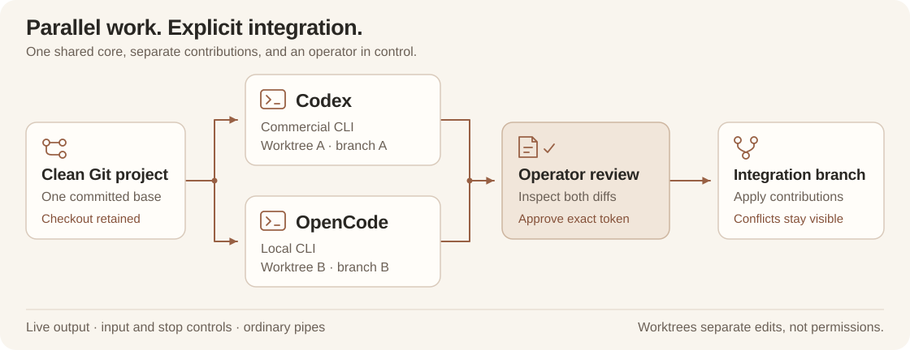

<div align="center">
  
  <h1>Koto</h1>
</div>

<p align="center">
  <a href="https://github.com/mehrdadxzaker/Koto/stargazers"></a>
  <a href="LICENSE"></a>
  <a href="https://github.com/mehrdadxzaker/Koto/actions/workflows/ci.yml"></a>
</p>

<p align="center"><strong>English</strong> · <a href="README.fa.md" lang="fa">فارسی</a></p>

<p align="center"><strong>Run multiple coding agents together, in one coordinated workspace.</strong></p>
<p align="center">Give each agent an isolated Git worktree, follow its output, review its changes, and bring the results together.</p>

<p align="center"><a href="#quick-start">Quick start</a> · <a href="#how-it-works">How it works</a> · <a href="#contributing">Contribute</a> · <a href="docs/PROJECT_SESSIONS.md">Session guide</a></p>

Koto coordinates agents you already use. You choose the task, executable, model
and permissions for each agent. Koto schedules their work, streams their output
and keeps contributions separate until you review them. A shared JavaScript
core powers the current CLI; future plugins and UIs will use the same API.

**Available now:** concurrent project sessions, isolated Git worktrees, terminal
controls and approval-based integration. The npm package is **not published to
the registry yet**; run from source or install a locally packed tarball.

## How it works



| You need to… | Koto provides |
| --- | --- |
| Use different agents at the same time | Concurrent execution through one scheduler; explicit task ownership and configurable limits |
| Keep edits apart | One branch and worktree per agent, all starting from the same commit |
| See and control work | Tagged stdout/stderr, process status, per-agent stop and optional pipe input |
| Decide what to keep | Complete contribution diffs, approval tokens tied to current contents and serial integration |
| Handle disagreement | Visible Git conflicts in a separate integration worktree; the original checkout is retained |
| Add another interface later | Shared workflow/session APIs and TypeScript declarations, with a thin CLI consumer |

### Observed with real agents

A [recorded macOS demonstration](https://github.com/mehrdadxzaker/Koto/pull/613)
used **Codex and OpenCode with local Qwen3-14B** to build a small task-board CLI.
Codex wrote the summary module while OpenCode wrote the CLI in another worktree.
Their native execution overlapped for **25.4 seconds**. Both diffs were inspected
and approved with review tokens, integration completed without conflict, and the
application ran manually with four tasks and 25% completion.

The record includes the initial local shell-quoting failure and its revision:
**two Codex and two local CLI invocations**, with owned cleanup confirmed. This
is evidence for one real pipe-based workflow on that Mac. Model-quality,
speed and cost comparisons remain unmeasured.

## Quick start

You need **Node.js 22+ and Git**, a clean committed project, and separately
installed agent CLIs. Configure their accounts, native permissions and any local
model server before launching work. Koto does not download models or provision
provider access. npm is needed only for packaging and development commands.
Git must be available through an absolute PATH entry. Use real executable
launchers; Windows `.cmd`/`.bat` wrappers need a native entry point or `$node`
with its script path, as described in the [session guide](docs/PROJECT_SESSIONS.md).

### 1. Get the core

```sh
git clone https://github.com/mehrdadxzaker/Koto.git
cd Koto
node bin/koto.js --help
node bin/koto.js project --help
```

There are no runtime dependencies or install hooks. You can run the CLI directly
from this checkout.

<details>
<summary>Prefer an npm-installed command?</summary>

Build and install the local package:

```sh
npm pack --ignore-scripts
npm install --global ./mehrdadxzaker-koto-3.0.0-alpha.0.tgz
koto project --help
```

The intended package name is `@mehrdadxzaker/koto`; registry publication remains
pending. See [installation](docs/INSTALLATION.md) for local npm/npx usage and
[the migration guide](docs/MIGRATION.md) if an older Python `koto` command is on
your PATH.

</details>

### 2. Describe the real work

Save a private `plan.json` **outside the target project**. Set an absolute project
path and give each agent a clear task and declared file ownership. The project
must have a clean working tree and a committed HEAD.

This example assigns two improvements to Koto itself. Point `project` at your
clean checkout, or replace the tasks and paths for your own project. The local
model identifier is the alias used in the Mac demonstration; configure or
replace it with your own local OpenCode provider/model alias.
The observed setup used Codex 0.164 and OpenCode 1.19.4. Match the arguments to
your installed versions and keep execution in the foreground; external daemon
jobs are outside Koto's owned process group.

<details open>
<summary>Example plan: Codex + OpenCode with local Qwen</summary>

```json
{
  "schemaVersion": 1,
  "project": "/absolute/path/to/Koto",
  "goal": "Improve terminal collaboration while keeping all interfaces on the shared core.",
  "maxConcurrency": 2,
  "timeoutMs": 300000,
  "agents": [
    {
      "id": "codex",
      "command": "codex",
      "args": ["--no-daemon", "--disable", "apps", "exec", "--json", "--model", "gpt-6.1-sol", "--sandbox", "workspace-write", "{prompt}"],
      "inputMode": "closed",
      "task": "Add a read-only session.outputTail(agentId) API with a bounded 64 KiB output tail and update its public declarations. Keep output private. Do not change the terminal renderer or add or run automated tests.",
      "owns": ["src/project-session.js", "src/core.d.ts"]
    },
    {
      "id": "local",
      "command": "opencode",
      "args": ["run", "--format", "json", "--model", "local-llama/qwen3-14b-q4_k_m", "--dir", "{workspace}", "{prompt}"],
      "inputMode": "closed",
      "task": "Make :status display a concise table with agent id, process status, pid and worktree path. Preserve existing controls. Do not change core modules or add or run automated tests.",
      "owns": ["bin/project.js"]
    }
  ]
}
```

</details>

Arguments are an array, not a shell command. Koto substitutes `{prompt}` and
`{workspace}`; it does not choose a provider or translate an agent protocol.
The native CLI controls its account, model access and usage. Review those
settings before launch; the [session guide](docs/PROJECT_SESSIONS.md) includes
an explicit ChatGPT-account configuration and environment controls.

`inputMode: "closed"` sends EOF after optional input, which matters for Codex
exec's piped stdin. Opt into `"pipe"` only when the selected CLI supports
ongoing stdin interaction.

### 3. Launch, supervise and review

From the Koto checkout:

```sh
node bin/koto.js project start /absolute/private/path/plan.json
```

The terminal lists the plan and requires you to type `start` before launching.
It prints the private session directory and integration-worktree path. Agent
output streams with its agent name and stdout/stderr label.

| Terminal command | Action |
| --- | --- |
| `:status` | Show process and worktree status |
| `:stop AGENT` / `:stop all` | Stop owned work and retain partial edits |
| `:send AGENT TEXT` / `:eof AGENT` | Send pipe input or EOF when enabled and supported |
| `:inspect AGENT` | Show the complete diff and its current review token |
| `:integrate AGENT TOKEN` | Integrate that exact reviewed contribution after all session agent processes finish |
| `:quit` | Stop remaining work and retain session worktrees |

You can also inspect and integrate after the terminal exits, without launching
another agent:

```sh
node bin/koto.js project inspect /private/session/directory codex
node bin/koto.js project integrate /private/session/directory codex --approve REVIEW_TOKEN
```

Integration writes to the **session's integration branch**, never directly to
your original project branch. Changed contents need a new review token. Conflicts
stay visible for ordinary Git resolution. Review the integrated result and run
your application before deciding how to bring it into your normal branch.

For a previously inspected plan, `--start --headless` supplies launch approval
and exits after execution. Use these flags when stdin/stdout are not a terminal.
They do not approve generated edits.

## Current boundaries

| Area | Current behavior |
| --- | --- |
| Terminal transport | Ordinary pipes. Full-screen terminal apps, PTY sessions and TTY/password prompts are unsupported. |
| Native agents | Raw executable/argv integration. Native completion records, structured permission states and continuation are not interpreted. |
| Permissions | Native agents keep their host permissions. Worktrees separate edits; they are not an OS sandbox. |
| Outcomes | A successful process exit records execution completion. Correctness still needs your review and actual application use. |
| Cancellation | POSIX process-group cleanup; self-detached descendants are outside that boundary. Windows interruption is best effort and can remain unconfirmed. |
| Recovery | No automatic agent retry, crash replay or worktree deletion. Native CLIs may perform their own retries. |
| Platforms | A real macOS pipe-based run is recorded. CI checks source/scope on Windows, macOS and Linux with Node 22/24; it does not qualify runtime/model behavior. |
| Delivery | CLI and shared API are implemented. IDE plugins, richer terminal interfaces and a GUI are later work, added one at a time. |

Prompts, native output and paths are retained in private local session files.
By default, controls live under `~/.koto/sessions` and worktrees under
`~/.koto/sessions-worktrees`; explicit control storage must be outside project
worktrees. These files survive uninstall. Keep credentials and private sessions
out of commits and issue reports. Read [security](SECURITY.md) and
[session boundaries](docs/PROJECT_SESSIONS.md#boundaries-and-retained-data).

## One core, multiple interfaces

```js
import { createProjectSession } from '@mehrdadxzaker/koto';

const session = await createProjectSession(plan, {
  onEvent: event => renderEvent(event)
});
const result = await session.run();
```

The package also exports `validateProjectPlan`, `inspectProjectSession`,
`integrateProjectSession`, `validateWorkflow` and `runWorkflow`.
Generic workflows use the JSON-stdin/text-stdout worker contract; project
sessions launch the native commands declared in their plan.

The order is **working core → delivery integrations → additional UIs**. Each
plugin or UI consumes the same session operations and events instead of
reimplementing scheduling, workspace ownership or integration. See the
[architecture](docs/ARCHITECTURE.md), [roadmap](docs/ROADMAP.md) and
[product scope](docs/SCOPE.md).

## Contributing

Start with [CONTRIBUTING.md](CONTRIBUTING.md), choose a focused improvement, and
record the behavior you directly observe. The repository currently uses source
and scope checks; automated suites and fixture demos are removed.

```sh
npm ci --ignore-scripts --no-audit --no-fund
npm run check
```

| Start here | Responsibility |
| --- | --- |
| [src/core.js](src/core.js) | Task-graph validation, scheduling, dependencies and cancellation |
| [src/project-session.js](src/project-session.js) | Project plan, session lifecycle, events and operator controls |
| [src/command-session.js](src/command-session.js) | Streamed executable lifecycle, input, bounds and cleanup |
| [src/project-workspaces.js](src/project-workspaces.js) | Worktree ownership, diff capture, review tokens and integration |
| [src/process-agent.js](src/process-agent.js) | Generic JSON worker protocol |
| [bin/project.js](bin/project.js) | Thin terminal consumer of the session API |
| [src/index.js](src/index.js) · [src/core.d.ts](src/core.d.ts) | Public exports and TypeScript declarations |

Keep model credentials, permission enforcement and provider-specific behavior in
the appropriate native runtime/adapter. Keep new interfaces thin. For defects,
include revision, Node version, OS and a sanitized reproduction in
[GitHub issues](https://github.com/mehrdadxzaker/Koto/issues). For private security
reports, follow [SECURITY.md](SECURITY.md).

Translations are welcome: keep commands and technical identifiers unchanged,
align content with this English README, and add reciprocal language links.

[Support](SUPPORT.md) · [Maintainers](MAINTAINERS.md) ·
[Code of conduct](CODE_OF_CONDUCT.md) · [Apache-2.0 license](LICENSE)
