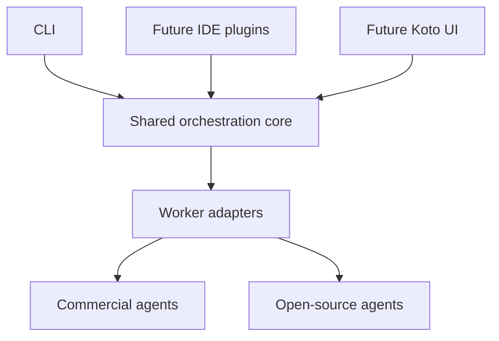

# Shared orchestration core

Koto's Node.js core is independent of an IDE, UI and model provider. All delivery
surfaces use the same core operations and worker-adapter boundary.
The package exports an ESM JavaScript API with TypeScript declarations for the
workflow, worker-adapter, event and result contracts. The runtime stays JavaScript.



## Current runtime

`validateWorkflow(workflow)` validates and normalizes an explicit task graph.
`runWorkflow(workflow, options)` schedules ready tasks and returns an attributed
report. Independent tasks run concurrently within the declared limits. A task
receives only its direct dependencies' successful outputs. Failed prerequisites
block downstream work while independent branches can finish.

The initial process-worker adapter invokes an executable without a shell. Its
stdin receives one JSON assignment:

```json
{
  "schemaVersion": 1,
  "goal": "Combine findings into one answer",
  "task": { "id": "integrate", "prompt": "Use both contributions" },
  "inputs": { "analysis": "First finding", "review": "Second finding" }
}
```

Stdout supplies the text result. Exit zero with valid, nonempty output and
confirmed cleanup establishes worker completion. An independent check is needed to establish answer quality.
The core does not infer semantic correctness from arbitrary output.

Workflow fields are `schemaVersion`, `goal`, `agents`, `tasks`, optional `finalTask`,
optional `maxConcurrency` and optional `timeoutMs`. Omit `finalTask` or set it to
`null` for independent contributions; their report has individual task results
and no final text output. An agent declares `command`,
optional `args` and optional `timeoutMs`; a task declares `id`, `agent`, `prompt`
and optional `dependsOn`. `$node` resolves to Koto's current Node executable.

## Lifecycle and execution boundaries

The core validates dependencies and cycles before launching work. It enforces
bounded concurrency, per-agent timeouts and a total deadline. Process workers
bound assignment, stdout and stderr sizes. Cancellation stops scheduling and
requests worker termination. On POSIX, the adapter cleans remaining helpers in
the owned process group after both normal and failed worker exits before
settling a result. Windows active cancellation uses best-effort `taskkill`.
Every built-in worker requires confirmed owned-workload cleanup before reporting
success. A vanished POSIX process group or a valid native helper acknowledgement
provides that evidence; sending a kill signal or observing a helper exit does
not. Unknown cleanup remains `cleanup_unconfirmed` (the generic JSON worker uses
`process_agent_cleanup_unconfirmed`) even when the command exited zero.

The private `owned-worker-lifetime` module owns deadlines, cancellation intent,
first failure, bounded stopping/draining and final outcome precedence for JSON
workers, pipes and native terminals. Each protocol adapter keeps its input/output
rules and each ownership adapter supplies its own cleanup evidence. This keeps
completion policy in one place without treating a native session like a process
group. Windows direct pipes cannot establish descendant ownership and therefore
cannot report successful cleanup; project sessions use the native Job helper.

Workers must await or stop their children before exiting. Self-detached
descendants outside the POSIX group are not contained; closed inherited pipes
can make them invisible to this adapter. Pure Node cannot guarantee Windows
descendant cleanup after their parent has already exited. These are the generic
process-worker adapter's limits; project sessions use the platform-specific
ownership mechanisms described below for terminal commands and Windows pipes.

Workflow lifecycle callbacks receive metadata. The final report contains worker
outputs and attribution and may therefore contain private content. The generic
workflow runner has no persistent transcript store, automatic retries or crash replay.

Injected JavaScript adapters receive an AbortSignal. They must cooperate with
cancellation; arbitrary code in the same process cannot be forcibly stopped by
the core. Built-in process workers provide a stronger owned-process boundary.

The generic process-worker adapter uses one explicit working directory. Project
sessions add separate worktree ownership around the same scheduler, described below.
Native provider continuation stays with its originating agent; explicit task
outputs supply handoffs.

## Project sessions

The project flow uses these shared boundaries:

| Module | Responsibility |
| --- | --- |
| `src/project-plan.js` | Expand explicit native runtime/model/task/ownership choices and inspect launch prerequisites without starting an agent |
| `src/project-session.js` | Validate executable plans, schedule commands through the core and retain native lifecycle and attempt records |
| `src/approved-contribution.js`, `src/project-session-store.js` | Own approved contribution attempts, durable state and leases, and explicit reconciliation |
| `src/owned-worker-lifetime.js` | Own bounded worker settlement, cancellation and cleanup qualification; share direct pipe process ownership |
| `src/native-agent.js` | Declare native capabilities, observe bounded Codex/OpenCode structured events and bind explicit continuation to the captured native identity and origin |
| `src/command-session.js` | Launch raw executable/argv commands without a shell; stream stdout/stderr, forward bounded input, enforce deadlines and stop owned processes |
| `src/terminal-session.js`, `src/terminal-helper.js` | Share bounded terminal transport and select/verify the explicitly built host helper; Windows pipe sessions also use this transport |
| `src/native-helper.js`, `src/linux-native-helper.js`, `src/windows-native-helper.js` | Build and verify the macOS PTY, Linux PTY and Windows ConPTY/Job Object helpers using existing host tools |
| `src/project-workspaces.js` | Create branches/worktrees, capture review trees and tokens, apply new contribution deltas and retain verified integration/conflict receipts |
| `bin/project.js`, `bin/launcher.js` | Expose guided setup/launch, output/input/stop, retained review, explicit integration and native continuation through the shared APIs |

`src/index.js` exports workflow operations and the project-session API. Later
plugins and UIs consume these operations rather than introducing another scheduler.

Unlike the JSON process-worker protocol, a project plan supplies each command's
actual arguments and optional raw stdin. These commands retain their own login,
tools and permission enforcement. `buildProjectPlan()` expands explicit native
command choices; `preflightProjectPlan()` reports missing executables, dirty
repositories and terminal/local-runtime prerequisites. Session creation uses
the same preflight before creating worktrees and pins resolved executable paths.
No configuration, helper build or model launch occurs during preflight.

Pipes are the default. Structured Codex and OpenCode profiles observe their
native JSONL events to distinguish process exit from native completion, retain
the conversation ID and report available usage. Unsupported capabilities stay
explicit. A completed native turn remains separate from correctness of its work.
Interactive profiles use the native terminal UI; approval interaction stays
inside that UI, and terminal bytes are not parsed into lifecycle claims.

The shared terminal transport provides duplex input, resize, foreground
attachment and cleanup acknowledgement. macOS uses an owned PTY session. Linux
uses procfs process identities and pidfds around the owned session; the required
kernel facilities must be available. Windows uses ConPTY for interactive
terminals and a Job Object for both terminal and pipe workloads. The helper is
built explicitly with the installed host toolchain and its source/binary receipt
is verified before launch. Source availability and compilation are separate from
observing actual terminal and agent behavior on that host.

`resumeProjectSession()` prepares an explicit follow-up in the original worktree
using the captured native conversation ID. The observer binds that ID to the
native protocol, executable path, original arguments, explicit model and other
origin settings. Continuation requires confirmed cleanup; it never chooses a
provider's latest conversation. Session locks and a retained-state fingerprint
prevent concurrent or stale prepared continuations. Attempts are retained, and
interrupted runs are not automatically replayed. See [native sessions](NATIVE_SESSIONS.md)
for exact capabilities, bounds and refusal conditions.

Each command edits its own Git worktree from the same base commit. Control files
and retained output live outside those worktrees. Declared file ownership is
checked before integration; it is advisory during execution and is not an OS
sandbox. Review includes committed, staged, unstaged and untracked contributions.
An operator must approve the current review token after every agent stops and
settles owned-process cleanup. Unconfirmed cleanup from any agent blocks both
integration and resume throughout the session. A missing or mismatched helper
cleanup acknowledgement cannot be replaced by the helper's exit alone.

The integration owner snapshots the reviewed contribution and applies it to the
separate integration branch. Review retains the complete change from the session
base as well as the delta since that agent's last successful integration. Repeat
integration applies only the delta, including reversions of earlier work. The
review token includes its baseline, and private receipts verify the snapshot,
reviewed tree and source/target ancestry before selecting that baseline.

Conflicts remain in the integration worktree and block further integration and
resume. The operator resolves and commits them manually, then calls
`finalizeProjectSessionIntegration()` with the exact current integration commit
they reviewed. Finalization verifies the clean target, completed cherry-pick,
retained conflict receipt and source/target history before saving a successful
baseline. It makes no automatic conflict decision. Ambiguous Git mutations or
receipt failures retain a lock for explicit recovery. The original checkout is
not updated, and branches/worktrees remain available for review and cleanup.

The approved-contribution module owns the ordered integration attempt: acquire
the session lease, check eligibility and current approval, retain intent before
Git mutation, retain its observed result, and only then clear the pending attempt.
It delegates Git mechanisms and the workspace lease to `project-workspaces`.
Unresolved attempts block both integration and resume. Explicit reconciliation
binds approval to the current attempt and observed Git state; it can record a
validated receipt or acknowledge an unchanged target. It never replays work or
automatically derives success from a changed ref. Git and session persistence
remain separate stores, so interrupted work can still require manual inspection.
See [reconciliation](PROJECT_SESSIONS.md#reconcile-an-interrupted-integration).

Project sessions retain private state and output logs, but do not automatically
retry commands or recover/replay interrupted agent runs. Custom Git drivers,
hidden index entries and changed symlinks have explicit refusal boundaries.
See [project sessions](PROJECT_SESSIONS.md) for the runnable interface and details.

At the October 28, 2026 checkpoint, the
[delivery tracker](https://github.com/mehrdadxzaker/Koto/issues/543) retains
actual `8291701` Mac fresh/returning CLI, local/native cooperation, structured
continuation and integration-delta results, plus accepted Linux behavior and
review/cleanup with its writer timeout disclosed. `05d1650` Windows controls and
`0635143` useful work/controlled cleanup and separate explicit integration retain
their actual IDs, original-file preservation and rehydration limitation.
The later `0635143` Ctrl-] failure was localized to second readline/raw-mode
setup raising stdin `EPIPE`, not to a proven underlying Windows cause.
Reviewed head `caa5ca6` changes only two internal CLI files: explicit successful
replacement raw-input ownership is acknowledged, otherwise prior mode is
restored; actual input loss and failed partial controls stop owned work, with
final stdin cleanup covering constructor-before-return failure without private
internals. Its 53-payload package identity and seven exact-head CI checks passed.
All native/runtime/core payloads remain unchanged from `0635143`. Final actual
uninstrumented idle CLI controls are accepted: Windows and Linux completed two
attach/detach/status cycles then stop/quit; Mac combines a retained two-handoff
controller-deadline partial with a separate ordinary stop/quit complement.
Cleanup and inactive state were confirmed; intentional cancellation exits and
the earlier failures remain recorded. No model tasks were repeated. These
observations complete the recorded CLI acceptance scope; unexercised conditional
branches retain individual status. See [current evidence](CORE_STATUS.md) and the
[acceptance run](USER_ACCEPTANCE.md) for exact artifacts, original execution
identities and limits. Delivery-head/main and issue completion are recorded
separately in #543. Registry publication, live Claude inference and general
coding qualification retain their stated limits.

## Later adapters and delivery

Commercial and open-source agent runtimes can implement the worker contract.
Codex and OpenCode have explicit structured and terminal profiles; other native
protocols require their own adapters. Naming a raw command after a provider does
not establish native protocol support. Each runtime retains its own
authentication, tools, model selection and permission enforcement.

Core acceptance precedes another UI or plugin. Later surfaces expose the same
operations and events without duplicating scheduling or collaboration logic.
Adaptive planning, automatic crash recovery and richer artifact integration
remain separate future work; explicit native continuation does not imply them.
