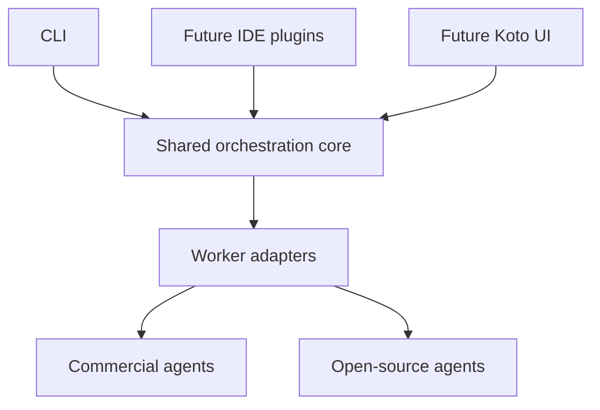

# Shared orchestration core

Koto's Node.js core is independent of an IDE, UI and model provider. All delivery
surfaces use the same core operations and worker-adapter boundary.
The package exports an ESM JavaScript API with TypeScript declarations for the
workflow, worker-adapter, event and result contracts. The runtime stays JavaScript.
Packed-package consumers are checked with strict NodeNext and Bundler resolution.



## Current runtime

`validateWorkflow(workflow)` validates and normalizes an explicit task graph.
`runWorkflow(workflow, options)` schedules ready tasks and returns an attributed
report. Independent tasks run concurrently within the declared limits. A task
receives only its direct dependencies' successful outputs. Failed prerequisites
block downstream work while independent branches can finish.

The initial process-worker adapter invokes an executable without a shell. Its
stdin receives one JSON assignment:

```json
{
  "schemaVersion": 1,
  "goal": "Combine findings into one answer",
  "task": { "id": "integrate", "prompt": "Use both contributions" },
  "inputs": { "analysis": "First finding", "review": "Second finding" }
}
```

Stdout supplies the text result. Exit zero with valid, nonempty output establishes
process completion. An independent check is needed to establish answer quality.
The bundled fixture integrator performs a check as part of its task; the core
does not infer semantic correctness from arbitrary output.

Workflow fields are `schemaVersion`, `goal`, `agents`, `tasks`, `finalTask`,
optional `maxConcurrency` and optional `timeoutMs`. An agent declares `command`,
optional `args` and optional `timeoutMs`; a task declares `id`, `agent`, `prompt`
and optional `dependsOn`. `$node` resolves to Koto's current Node executable.
See the [runnable example](../examples/cooperative-workflow.json).

## Lifecycle and execution boundaries

The core validates dependencies and cycles before launching work. It enforces
bounded concurrency, per-agent timeouts and a total deadline. Process workers
bound assignment, stdout and stderr sizes. Cancellation stops scheduling and
requests worker termination. On POSIX, the adapter cleans remaining helpers in
the owned process group after both normal and failed worker exits before
settling a result. Windows active cancellation uses best-effort `taskkill`.
When process-tree cleanup cannot be confirmed, the result records that failure
instead of claiming cancellation completed.

Workers must await or stop their children before exiting. Self-detached
descendants outside the POSIX group are not contained; closed inherited pipes
can make them invisible to the adapter. Pure Node cannot guarantee Windows
descendant cleanup after their parent has already exited. Stronger isolation
and Windows job ownership are required before claiming those guarantees.

Lifecycle callbacks receive metadata. The final report contains worker outputs
and attribution and may therefore contain private content. The initial runtime
has no persistent transcript store, automatic retries or crash replay.

Injected JavaScript adapters receive an AbortSignal. They must cooperate with
cancellation; arbitrary code in the same process cannot be forcibly stopped by
the core. Built-in process workers provide a stronger owned-process boundary.

The working directory and executable configuration are explicit. The current
adapter does not create sandboxes or isolated Git worktrees. Its deterministic
example is text-only. Coding integrations need their own workspace isolation,
permissions and a designated integration owner before concurrent edits are
supported. Native provider continuation stays with its originating agent;
explicit task outputs supply handoffs.

## Later adapters and delivery

Commercial and open-source agent runtimes can implement the worker contract.
Native Codex and Claude Code protocols require actual adapters; installing the
core does not automatically integrate them. Each runtime retains its own
authentication, tools, model selection and permission enforcement.

IDE plugins and Koto's UI will expose core operations and events. They must not
duplicate task scheduling or collaboration logic. Adaptive planning, persistent
recovery, model scorecards and richer artifact integration can be added within
the core when implemented and verified; they are not present in this slice.
