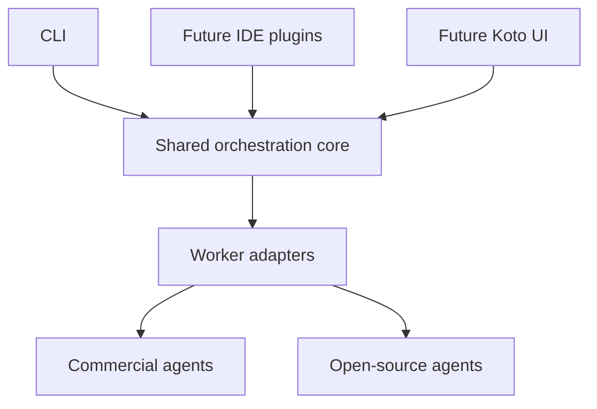

# Shared orchestration core

Koto's Node.js core is independent of an IDE, UI and model provider. All delivery
surfaces use the same core operations and worker-adapter boundary.
The package exports an ESM JavaScript API with TypeScript declarations for the
workflow, worker-adapter, event and result contracts. The runtime stays JavaScript.



## Current runtime

`validateWorkflow(workflow)` validates and normalizes an explicit task graph.
`runWorkflow(workflow, options)` schedules ready tasks and returns an attributed
report. Independent tasks run concurrently within the declared limits. A task
receives only its direct dependencies' successful outputs. Failed prerequisites
block downstream work while independent branches can finish.

The initial process-worker adapter invokes an executable without a shell. Its
stdin receives one JSON assignment:

```json
{
  "schemaVersion": 1,
  "goal": "Combine findings into one answer",
  "task": { "id": "integrate", "prompt": "Use both contributions" },
  "inputs": { "analysis": "First finding", "review": "Second finding" }
}
```

Stdout supplies the text result. Exit zero with valid, nonempty output establishes
process completion. An independent check is needed to establish answer quality.
The core does not infer semantic correctness from arbitrary output.

Workflow fields are `schemaVersion`, `goal`, `agents`, `tasks`, optional `finalTask`,
optional `maxConcurrency` and optional `timeoutMs`. Omit `finalTask` or set it to
`null` for independent contributions; their report has individual task results
and no final text output. An agent declares `command`,
optional `args` and optional `timeoutMs`; a task declares `id`, `agent`, `prompt`
and optional `dependsOn`. `$node` resolves to Koto's current Node executable.

## Lifecycle and execution boundaries

The core validates dependencies and cycles before launching work. It enforces
bounded concurrency, per-agent timeouts and a total deadline. Process workers
bound assignment, stdout and stderr sizes. Cancellation stops scheduling and
requests worker termination. On POSIX, the adapter cleans remaining helpers in
the owned process group after both normal and failed worker exits before
settling a result. Windows active cancellation uses best-effort `taskkill`.
When process-tree cleanup cannot be confirmed, the result records that failure
instead of claiming cancellation completed.

Workers must await or stop their children before exiting. Self-detached
descendants outside the POSIX group are not contained; closed inherited pipes
can make them invisible to the adapter. Pure Node cannot guarantee Windows
descendant cleanup after their parent has already exited. Stronger isolation
and Windows job ownership are required before claiming those guarantees.

Workflow lifecycle callbacks receive metadata. The final report contains worker
outputs and attribution and may therefore contain private content. The generic
workflow runner has no persistent transcript store, automatic retries or crash replay.

Injected JavaScript adapters receive an AbortSignal. They must cooperate with
cancellation; arbitrary code in the same process cannot be forcibly stopped by
the core. Built-in process workers provide a stronger owned-process boundary.

The generic process-worker adapter uses one explicit working directory. Project
sessions add separate worktree ownership around the same scheduler, described below.
Native provider continuation stays with its originating agent; explicit task
outputs supply handoffs.

## Project sessions

The local project flow has four boundaries:

| Module | Responsibility |
| --- | --- |
| `src/project-session.js` | Validate executable plans, schedule commands through the core, retain lifecycle records, enforce declared ownership during integration |
| `src/command-session.js` | Launch raw executable/argv commands without a shell; stream stdout/stderr, forward bounded input, enforce deadlines and stop owned processes |
| `src/project-workspaces.js` | Create branches/worktrees from one clean HEAD, capture review trees and tokens, snapshot contributions and integrate into the designated integration worktree |
| `bin/project.js` | Display output/status and expose launch approval, input/EOF, stop, review and explicit integration controls |

`src/index.js` exports workflow operations and the project-session API. Later
plugins and UIs consume these operations rather than introducing another scheduler.

Unlike the JSON process-worker protocol, a project plan supplies each command's
actual arguments and optional raw stdin. These commands retain their own login,
tools and permission enforcement. Pipes provide no PTY, native approval protocol,
continuation translation or verified native completion. A zero exit is a process
result, not a correctness verdict.

Each command edits its own Git worktree from the same base commit. Control files
and retained output live outside those worktrees. Declared file ownership is
checked before integration; it is advisory during execution and is not an OS
sandbox. Review includes committed, staged, unstaged and untracked contributions.
An operator must approve the current review token after commands stop. The
integration owner snapshots the reviewed contribution and applies it to the
separate integration branch. Conflicts remain visible; the original checkout
is not updated, and session branches/worktrees are retained for explicit review
and cleanup.

Project sessions retain private state and output logs, but do not automatically
retry commands or recover/replay interrupted agent runs. Custom Git drivers,
hidden index entries and changed symlinks have explicit refusal boundaries.
See [project sessions](PROJECT_SESSIONS.md) for the runnable interface and details.

A [recorded macOS demonstration](https://github.com/mehrdadxzaker/Koto/pull/613)
used the same implementation tree now on `main`: Codex and OpenCode with local
Qwen3-14B ran over pipes with 25.4 seconds of overlapping execution, followed by
inspection and token-approved integration of both contributions. One manual
application run does not qualify other platforms, native protocols or model
quality; PTY support remains absent.

## Later adapters and delivery

Commercial and open-source agent runtimes can implement the worker contract.
Native Codex and Claude Code protocols require actual adapters; configuring
their executable as a raw command does not provide one. Each runtime retains its
own authentication, tools, model selection and permission enforcement. PTY
sessions are also not implemented in this source line.

IDE plugins and Koto's UI will expose core operations and events. They must not
duplicate task scheduling or collaboration logic. Adaptive planning, persistent
recovery, model scorecards and richer artifact integration can be added within
the core when implemented and verified; they are not present in this slice.
